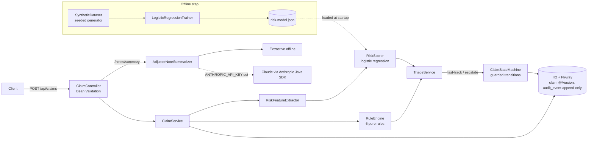

# claimflow

claimflow is a Spring Boot service for insurance claims. It takes first-notice-of-loss (FNOL) intake for auto and property claims, runs a deterministic rules engine and a logistic-regression risk model on each claim, and sends it either to straight-through fast-track approval or to a human adjuster. Claims then move through an explicit, guarded state machine that writes an append-only audit trail and uses optimistic locking. The technically interesting part is that every routing decision can be explained. Each claim carries the result of every rule and the model's top contributing features. The model is trained offline in plain Java on a seeded **synthetic** dataset and loaded from a JSON weights file at startup, so training and serving share one feature definition.

## Features

- **FNOL intake API** with Bean Validation (policy, claimant, auto/property claim type, loss date, line items, document metadata). Errors use RFC 9457 problem responses.
- **Rules engine** with six pure rules:
  - coverage / line-of-business match
  - policy in force on the loss date (term and cancellation)
  - deductible
  - duplicate-claim detection (same policy, loss within ±3 days, amount within 10%)
  - late reporting (more than 30 days)
  - amount vs. policy limit

  It also computes the payable amount (claimed minus deductible, capped at the limit).
- **Risk score** from an L2-regularised logistic regression with 9 features. It returns a score, a band (LOW/MEDIUM/HIGH) and the top-3 signed feature contributions.
- **Triage**: a claim is fast-tracked only when all rules pass, the risk band is LOW, and the total is at most 15,000 (configurable). Everything else goes to `IN_REVIEW`.
- **State machine**: `SUBMITTED → TRIAGED → (FAST_TRACK_APPROVED | IN_REVIEW → APPROVED / DENIED / NEEDS_INFO) → PAID → CLOSED`. Guards include "approved amount ≤ payable" and "deny/request-info needs a reason". Illegal moves return 422.
- **Append-only audit trail**: the entity is Hibernate `@Immutable` and its repository can only insert and read.
- **Optimistic locking**: JPA `@Version`, plus an `expectedVersion` on every adjuster action. Stale writes return 409.
- **Adjuster notes + summariser**: the `AdjusterNoteSummarizer` interface has two implementations.
  - An offline extractive implementation (the default, deterministic).
  - A Claude implementation (`claude-opus-5-5`, official Anthropic Java SDK 3.6.0, structured outputs, effort `medium`, server-side refusal fallback). It is used only when `ANTHROPIC_API_KEY` is set.
- **Offline training + benchmark** scripts that run from the Maven Wrapper.

## Architecture



- **The state machine is a pure lookup table.** It maps each `(state, action)` pair to a target state and a guard. Anything not in the table is rejected. This lets the whole workflow be unit-tested without Spring, and adding a state is a one-line change.
- **Rules and the model run side by side, not in sequence.** Rules produce explainable PASS/WARN/FAIL findings. The model adds a probability with per-feature contributions (`weight × standardised value`). Triage needs both to agree before it skips a human.
- **Training is offline and in Java.** Training and serving use the same `RiskFeatures` record and transforms (`toVector()`), and the runtime only reads a JSON weights file. Retraining means running one command and committing the JSON.
- **Every transition writes an audit row in the same transaction** as the status change. Adjuster actions must send the version they saw, so two adjusters cannot silently overwrite each other. A race that gets past that check is still caught by JPA `@Version`.
- **The LLM is optional.** The summariser sits behind an interface, and the offline implementation is selected automatically without an API key. Tests, CI and the benchmark never touch the network.

## Quickstart

Requires Java 21. Maven is fetched by the wrapper.

```bash
./mvnw -B verify                       # build + 45 tests
java -jar target/claimflow-0.1.0.jar   # starts on :8080 with H2 in-memory + seeded SYNTHETIC policies
```

To retrain the model (this rewrites `data/synthetic_claims.csv` and `src/main/resources/model/risk-model.json` deterministically):

```bash
./mvnw -q compile exec:java -Dexec.mainClass=io.github.claimflow.ml.TrainModel
# train=9657 test=2343 threshold=0.0557 AUC=0.7836 precision=0.173 recall=0.843 fastTrack=0.562
```

Example FNOL request (real output, abridged; run on 2026-11-06 on port 8089):

```bash
curl -s -X POST localhost:8089/api/claims -H 'Content-Type: application/json' -d '{
  "policyNumber":"POL-AUTO-0001","type":"AUTO","lossDate":"2026-11-04",
  "description":"Rear-ended at a stop light",
  "claimant":{"firstName":"Alex","lastName":"Example","email":"alex@example.test"},
  "lineItems":[{"coverage":"COLLISION","description":"Rear bumper and trunk lid","amount":2350.75}],
  "documents":[{"type":"POLICE_REPORT","fileName":"report.pdf","contentType":"application/pdf","sizeBytes":120400},
               {"type":"PHOTO","fileName":"rear.jpg","contentType":"image/jpeg","sizeBytes":880000}]}'
```

```json
{
  "claimNumber": "CLM-2068C35FC6E3",
  "status": "FAST_TRACK_APPROVED",
  "totalClaimed": 2350.75,
  "payableAmount": 1850.75,
  "approvedAmount": 1850.75,
  "version": 1,
  "triage": {
    "rules": [
      {"code": "COVERAGE", "outcome": "PASS", "message": "All line items fall under policy coverages"},
      {"code": "POLICY_ACTIVE", "outcome": "PASS", "message": "Policy in force on loss date 2026-11-04"},
      {"code": "DEDUCTIBLE", "outcome": "PASS", "message": "Deductible 500.00 applied"},
      {"code": "DUPLICATE", "outcome": "PASS", "message": "No similar claim on this policy"},
      {"code": "LATE_REPORTING", "outcome": "PASS", "message": "Reported 2 day(s) after loss"},
      {"code": "POLICY_LIMIT", "outcome": "PASS", "message": "Within policy limit 50000.00"}
    ],
    "risk": {
      "score": 0.0139, "band": "LOW", "threshold": 0.055676,
      "topFactors": [
        {"feature": "has_police_report", "value": 1.0, "contribution": -0.3964},
        {"feature": "log_policy_age_days", "value": 6.257667587882639, "contribution": -0.1732},
        {"feature": "prior_claims_12m", "value": 0.0, "contribution": -0.1508}
      ]
    },
    "fastTrack": true,
    "routingReasons": ["All rules passed, low risk, under fast-track cap"]
  },
  "availableActions": ["PAY"]
}
```

A property claim reported 47 days late with an uncovered line item was routed to review. Its triage output (real) was:

```json
"routingReasons": [
  "FAIL COVERAGE: Policy does not include coverage: LOSS_OF_USE",
  "WARN LATE_REPORTING: Reported 47 days after loss (limit 30)",
  "Risk score 0.436 is at or above threshold 0.055676"
]
```

Acting on that claim with an outdated version returns
`409 {"title":"Version conflict","detail":"Claim CLM-EE41488B3FB3 is at version 1 but the request expected 0"}`.

Other endpoints:

| Method | Path | Purpose |
|---|---|---|
| GET | `/api/claims/{claimNumber}` | claim lookup |
| GET | `/api/claims?status=IN_REVIEW` or `?policyNumber=…` | search |
| POST | `/api/claims/{claimNumber}/actions` | `{"action":"APPROVE|DENY|REQUEST_INFO|PROVIDE_INFO|PAY|CLOSE","expectedVersion":1,"actor":"…","reason":"…","amount":…}` |
| GET | `/api/claims/{claimNumber}/audit` | audit trail |
| POST / GET | `/api/claims/{claimNumber}/notes`, `/notes/summary` | adjuster notes and summary |

## Results

Command (writes `bench/RESULTS.md`):

```bash
./mvnw -q test-compile exec:java -Dexec.classpathScope=test -Dexec.mainClass=io.github.claimflow.bench.BenchmarkMain
```

Measured 2026-11-06 on an Intel Core i7-12700 (16 logical CPUs), Windows 11 Pro, Temurin Java 21.0.13. All data is **synthetic**: (a) uses the held-out 20% split of `data/synthetic_claims.csv` (12,000 rows, seed 20261106), and (b) sends seeded random FNOL payloads against 2,000 generated policies. The note summariser plays no part in these numbers. No LLM-quality numbers were measured.

**(a) Risk model, held-out synthetic split (2,343 rows, 9.0% positive)**

| metric | value |
|---|---|
| ROC AUC | 0.7836 |
| threshold (chosen on the train split for recall ≥ 0.80) | 0.0557 |
| precision @ threshold | 0.173 |
| recall @ threshold | 0.843 |
| fast-track rate from the model alone (score < threshold) | 56.2% |
| risky rate among model-fast-tracked rows | 2.5% |
| scoring throughput (in-process, 1 thread) | ~2.9 M scores/s |

**(b) FNOL intake + triage over HTTP.** The server is in-process Tomcat with H2 in-memory. The client is `java.net.http` on the same machine. Each run used 5,000 requests after 1,500 warm-up requests.

| concurrency | claims/s | p50 ms | p95 ms | p99 ms | outcomes |
|---|---|---|---|---|---|
| 1 | 318 | 2.62 | 6.65 | 9.31 | 2,373 fast-track / 2,627 review |
| 8 | 2,346 | 2.65 | 7.22 | 11.94 | 2,195 fast-track / 2,805 review |

In the end-to-end run, 43.9–47.5% of claims were fast-tracked. That is lower than the model-only 56%, because the rules (late reporting, policy not yet in force, duplicates) and the 15,000 amount cap also block fast-track. Throughput numbers are for a laptop-class desktop with an in-memory database. They are not a production capacity claim.

## Tests / CI

- `./mvnw -B verify` runs 45 JUnit 5 tests:
  - state machine (16)
  - rules (9)
  - scoring and feature extraction (5)
  - training, metrics and generator determinism (4)
  - summariser (3)
  - Spring Boot integration tests over MockMvc (8): fast-track to closed with the audit trail, review and approval guard, stale version 409, JPA `@Version` conflict, duplicates, deny/system-action rejection, validation 400 / 404, lookup and notes summary.
- The compiler runs with `-Xlint:all -Werror`.
- The integration tests pin "today" with `claimflow.clock.fixed-date=2026-11-06`, so they stay valid against the fixed policy terms in the seed data.
- GitHub Actions (`.github/workflows/ci.yml`) runs Temurin 21 and `./mvnw -B verify`.

## How the synthetic data is generated

`SyntheticDataset` (seed 20261106, 12,000 rows, 20% held out at random) draws each feature independently:

| feature | distribution |
|---|---|
| property claim | Bernoulli(0.4) |
| policy age in days | uniform 0–1500, but uniform 0–60 for 15% of rows |
| days to report | Exponential with mean 4, or mean 45 for 10% of rows |
| amount / limit | log-normal around 0.08 (σ 0.9), clipped to [0.002, 1.5] |
| prior claims | Poisson(0.3) |
| documents | Poisson(2) |
| police report | probability 0.5 for auto, 0.15 for property |
| round amount | Bernoulli(0.15) |
| line items | 1 + Poisson(1.2) |

The label is a Bernoulli draw from the sigmoid of a hand-written logit with these terms:

- Raise risk: amount ratio, log days-to-report, prior claims, round amount, property, line items.
- Lower risk: log policy age, documents, police report.
- One non-linear bonus: new policy AND claim over 30% of the limit.
- Gaussian noise with σ = 0.5.

"Positive" means "would be referred for investigation" under this invented process. It is not real fraud data.

## Limitations and next steps

- **The model is a toy on synthetic data.** The generating process is almost linear in the same features the model uses, so the AUC is optimistic. It says nothing about real claims fraud. Real use would need labelled historical claims, calibration checks and a fairness review.
- **The rules are simplified.** There is a single coverage limit and deductible per policy (no per-coverage sub-limits), the duplicate rule uses fixed tolerances, and there are no state-specific late-reporting rules.
- **The audit trail is append-only at the application level**, through `@Immutable` and an insert/read-only repository. A production setup would also revoke UPDATE/DELETE grants or add a database trigger.
- **There is no authentication or authorisation.** `actor` is supplied by the client.
- **Documents are metadata only.** No files are stored.
- **The Claude summariser compiles but was not run.** It is built against the official Anthropic Java SDK 3.6.0, but no live API call was made while building this project, and no tests exercise it (tests must not use the network).
- **The H2 schema is not portable yet.** Flyway migrations target H2. Postgres would need a separate profile and an adjusted DDL.
- **The codebase is bigger than the 2,500-line target.** It is about 3,300 lines of Java including tests, mostly because of JPA entity boilerplate.
- **Next steps:** a Postgres + Testcontainers profile, per-coverage limits, model calibration plots, and an outbox for payment events.
